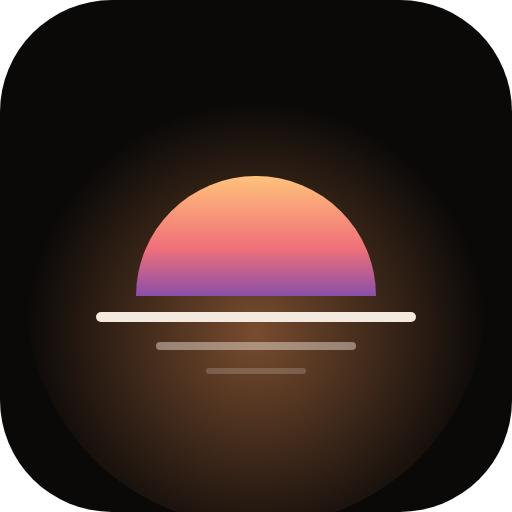
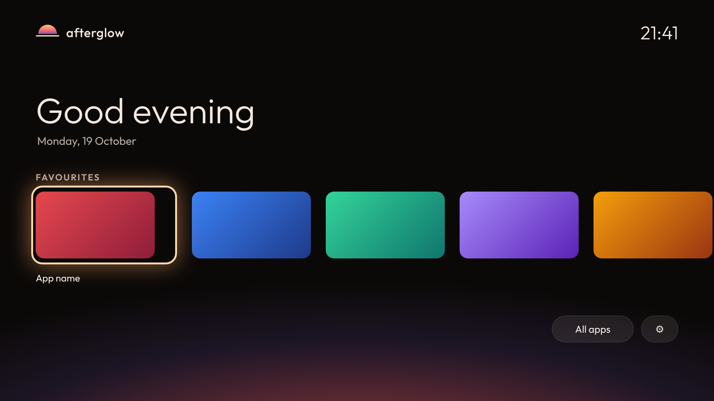

<p align="center">
  
</p>

<h1 align="center">afterglow</h1>
<p align="center"><b>A clean, fast, ad-free home screen for Google TV and Android TV.</b></p>
<p align="center"><a href="https://afterglow.nbansal28.com">afterglow.nbansal28.com</a></p>


<sub>Preview render of the home screen. Real screenshots from a TV will replace it.</sub>

## What it is
Google TV's home screen is slow, full of recommendations and ads, and heavy on older TVs. Afterglow is a small launcher that
shows your own apps and nothing else: no ads, no recommendations, no tracking.

- **Favourites row** with each app's own banner, and an **All apps** grid.
- **Hold OK** on an app for options: favourite, reorder, hide, rename, app info.
- A big **clock and greeting** (always 24-hour), and a soft sunset glow in the background that follows the time of day.
- **Updates itself** from GitHub Releases (Settings > Afterglow settings > About). No Play Store involved.
- Light on purpose: one module, almost no libraries, no background services.
- The remote's **Settings** key and the **mic button** keep working.

Requires **Android 11 or newer**. Tested on a TCL 65Q6C (Google TV, Android 14). Other TVs should work as an app, but the
Home-button takeover below has only been verified on that TCL.

## Install
1. Download the latest `afterglow-x.y.z.apk` from the [Releases](https://github.com/aviato28/AfterGlow/releases) page.
2. Put it on the TV, for example with the **Downloader** app (enter the APK's link) or `adb install`.
3. Open **Afterglow** from the apps row. Afterglow then updates itself from the inside.

## Making Afterglow your Home button
Google TV does not let apps replace the Home button, and each brand locks it differently. Afterglow never does this behind your
back, and **it can always be undone**: nothing is uninstalled, only switched off.

- **TCL Google TV (verified on the 65Q6C):** follow [`docs/TAKEOVER-TCL.md`](docs/TAKEOVER-TCL.md). It needs a phone or tablet with
  Termux and takes about ten minutes. Read the "safety net" section first: the TV must stay reachable after a restart, or a bad
  state cannot be undone. An in-app version with a Restore button is being built.
- **Other TVs:** the same idea (switch off the stock launcher with `pm disable-user`) works on many TVs. The
  [tv-vibehack](https://github.com/Gathin23/tv-vibehack) project documents it for several brands.
- **Undo, any time:** re-enable the apps you switched off (see the recipe), or on the TV: Settings > Apps > See all apps > Show
  system apps > enable them. A factory reset also restores everything.

Do this at your own risk. Test the "reach the TV after a restart" step before changing anything.

## Privacy
No ads, no analytics, no accounts. The only network connection is to GitHub, to check for and download updates.
Afterglow never installs or updates other apps (Netflix, YouTube and others update through the Play Store, which keeps
HDR, Dolby Vision and 4K working).

## Status and roadmap
See [`docs/ROADMAP.md`](docs/ROADMAP.md). Next: in-app takeover and Restore, first-run setup, a "speed up my TV" list, a clock
screensaver, then 1.0.

## Build from source
```
./gradlew testDebugUnitTest assembleRelease
```
Needs JDK 17 and the Android SDK. Releases are built and signed by GitHub Actions (`.github/workflows/`, see `docs/RELEASING.md`).

## Licence
MIT, see [LICENSE](LICENSE). The Outfit font is under the SIL Open Font License.
Afterglow is an independent project and is not affiliated with Google, TCL or any streaming service.
